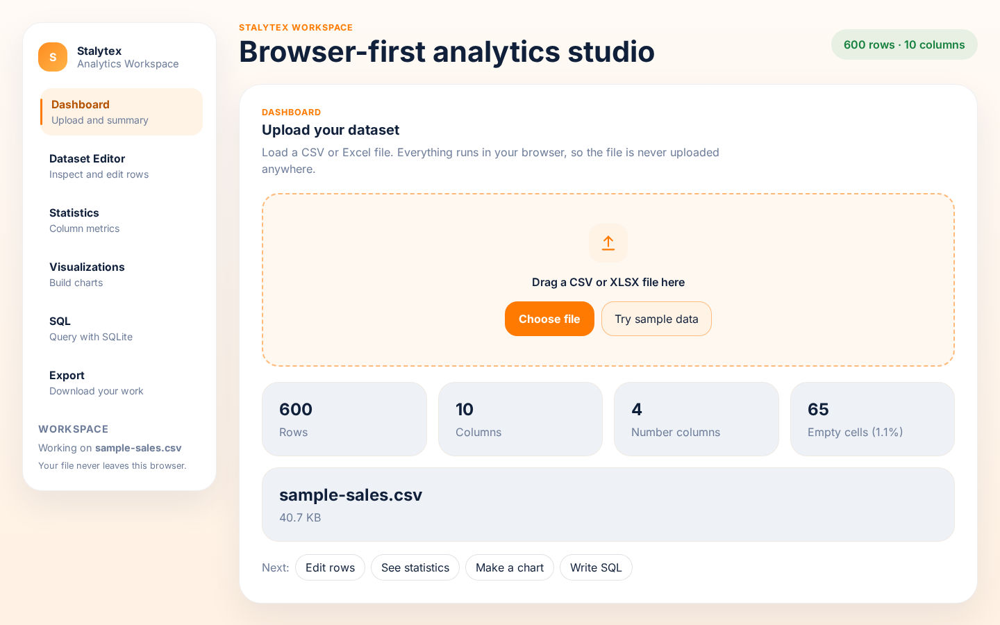

# Stalytex

A browser-based analytics workspace for CSV and Excel files. Upload a dataset, clean and edit it, look at
column statistics, build charts and run SQL queries on it. Everything runs in the browser, so the data never
leaves your computer and there is no backend to set up.



## Why I built it

For small datasets I kept switching between Excel, a SQL tool and a charting tool. I wanted one simple place
to upload a file and quickly answer basic questions about it.

## Features

- **Upload:** CSV (parsed with PapaParse) or XLSX (SheetJS), with a summary of rows, columns, numeric columns,
  empty cells and file size.
- **Dataset editor:** search, sort, filter by column, paginate, edit cells, add or delete rows and columns.
- **Statistics:** per-column min, max, average, unique values and empty cells.
- **Visualizations:** bar, line, area, pie, scatter and histogram charts (Recharts). Pick the X and Y columns and the colour.
- **SQL:** the uploaded table is loaded into an in-browser SQLite database (sql.js), so you can run normal SQL
  queries like `SELECT country, SUM(revenue) FROM data GROUP BY country`.
- **Export:** download the edited data as CSV or XLSX, and charts as PNG (html2canvas).

## Tech stack

React 18, TypeScript, Vite, Recharts, PapaParse, SheetJS (xlsx), sql.js, html2canvas

## Run locally

```bash
git clone https://github.com/Tejdeep-67/Stalytex.git
cd Stalytex/frontend
npm install
npm run dev
```

Then open the URL shown in the terminal (usually http://localhost:5173).

To make a production build: `npm run build` (output in `frontend/dist`). The repo has a `netlify.toml`
for deploying on Netlify.

## Project structure

```
frontend/src/
├── App.tsx                 # file upload, state, page switching
├── components/
│   ├── Dashboard.tsx       # upload + dataset summary
│   ├── DatasetEditor.tsx   # table editing, sort, filter
│   ├── Statistics.tsx      # column metrics
│   ├── Visualizations.tsx  # charts
│   ├── SQLCompiler.tsx     # sql.js queries
│   ├── ExportPanel.tsx     # CSV / XLSX / PNG export
│   └── Sidebar.tsx
└── types.ts
```

## Limitations

- Everything is in memory, so very large files (hundreds of MB) will be slow.
- Changes are not saved between sessions; export the file to keep them.

## License

MIT
