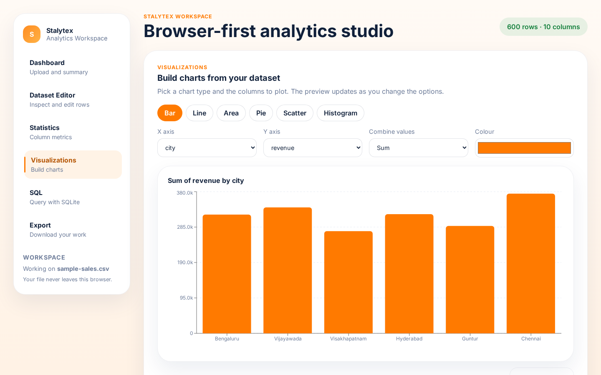
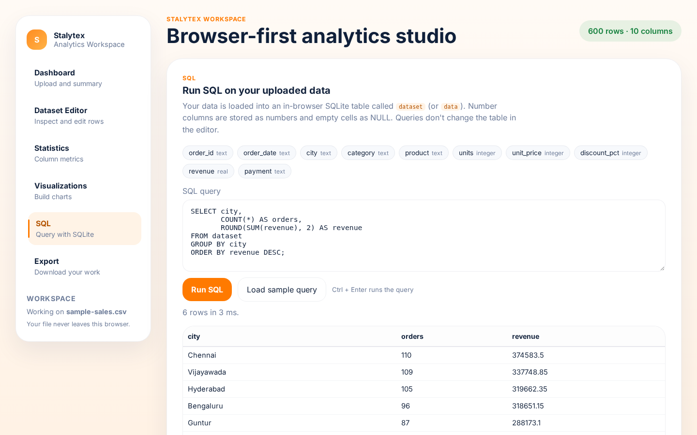
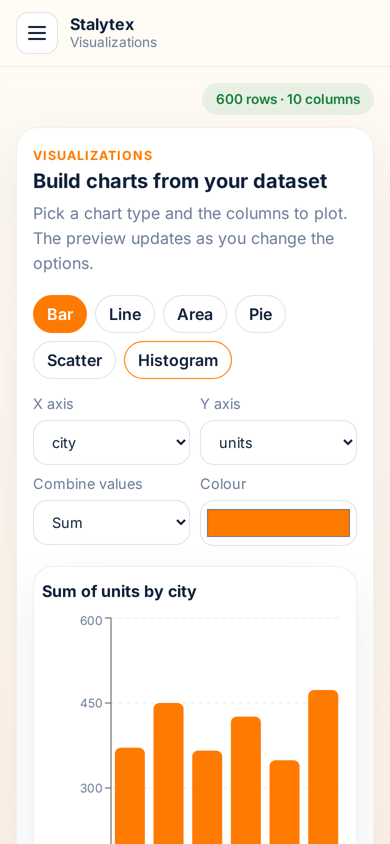

# Stalytex

A browser-based analytics workspace for CSV and Excel files. Upload a dataset, clean and edit it, look at
column statistics, build charts and run SQL on it. Everything runs in the browser, so the data never leaves
your computer and there is no backend to set up.

**Live:** https://stalytex.netlify.app


## Why I built it

For small datasets I kept switching between Excel, a SQL tool and a charting tool. I wanted one simple place
to upload a file and quickly answer basic questions about it.

## Features

- **Upload:** CSV or XLSX by drag and drop or the file picker. Shows rows, columns, number columns, empty cells
  and file size. There's a "Try sample data" button if you just want to look around (the sample is a made-up
  sales file, 600 rows).
  - single-column and uneven (ragged) CSVs load fine, with a warning for the uneven rows
  - Excel dates show as dates instead of serial numbers like `45717`
  - duplicate headers are renamed (`Qty`, `Qty (2)`) instead of one silently overwriting the other
  - a file that fails to load doesn't wipe the dataset you already had open
- **Dataset editor:** search, filter by column, sort (numbers sort as numbers, blanks go last), pagination,
  edit any cell (Enter saves, Esc cancels), add/delete rows and columns. Deletes can be undone from the toast.
- **Statistics:** count, missing, unique, mean, median, standard deviation, min, max, 25th/75th percentile,
  sum and range for number columns, most frequent values for text columns, plus a table that summarises
  every column at once. I checked the numbers against pandas `describe()` and they match.
- **Visualizations:** bar, line, area, pie, scatter and histogram (Recharts). Pick X, Y, how to combine values
  (sum, average or count) and the colour. The chart updates as you change the options. Large files are
  capped so the chart stays readable (top 30 bars, pie shows top 7 + "Other", scatter samples 2,000 points).
- **SQL:** the dataset is loaded into SQLite in the browser (sql.js). The table is called `dataset`
  (`data` also works). Number columns are stored as real numbers and empty cells as `NULL`, so things like
  `WHERE price > 1000`, `AVG()` and `ORDER BY` behave the way you'd expect.

  ```sql
  SELECT city, COUNT(*) AS orders, ROUND(SUM(revenue), 2) AS revenue
  FROM dataset
  GROUP BY city
  ORDER BY revenue DESC;
  ```
- **Export:** the edited data as CSV (with a BOM so Excel shows accents and ₹ properly) or XLSX (numbers and
  dates saved as real numbers/dates, not text), and the current chart as a PNG.
- **Works on phones:** the sidebar turns into a slide-in menu, tables scroll inside their box and charts resize.

| Charts | SQL |
| --- | --- |
|  |  |



## Tech stack

React 18, TypeScript, Vite, Recharts, PapaParse, SheetJS (xlsx), sql.js, html2canvas, Vitest

## Run locally

You need Node 18 or newer (I use 20).

```bash
git clone https://github.com/Tejdeep-67/Stalytex.git
cd Stalytex/frontend
npm install
npm run dev
```

Then open the URL shown in the terminal (usually http://localhost:5173).

Other scripts:

```bash
npm test          # unit tests (vitest)
npm run build     # type check + production build into frontend/dist
npm run preview   # serve the production build
```

## Deploying

The repo has a `netlify.toml` at the root: base directory `frontend`, build command `npm run build`,
publish directory `dist`, Node 20. All routes fall back to `index.html`.

## How it's built

- `App.tsx` holds the dataset (`headers` + `rows`) and passes it down to each page. Rows are kept as strings
  exactly as they were in the file, and each page decides how to read them.
- The actual logic lives in small files in `src/lib/` so it can be tested without a browser:
  - `parse.ts` / `excel.ts` turn CSV text or an Excel sheet into headers + rows
  - `numbers.ts` decides what counts as a number (`1,250` does, an empty cell doesn't)
  - `table.ts` does search, filter and sort on row indexes, so editing a sorted table edits the right row
  - `stats.ts` does the statistics (percentiles use the same method as numpy/pandas)
  - `chartData.ts` groups and aggregates data for each chart type
  - `sql.ts` creates the SQLite table with a type for each column
  - `exportData.ts` / `exportXlsx.ts` build the CSV and Excel files
- The charts, SQLite and the Excel library are the heavy parts, so they are only downloaded when you first use
  them. The first page load is about 190 KB of JS instead of 1.1 MB.
- I tested with a 200,000 row CSV: it loads in under half a second and sorting, statistics and the first SQL
  query each take well under a second.

```
frontend/src/
├── App.tsx
├── components/
│   ├── Dashboard.tsx       # upload + dataset summary
│   ├── DatasetEditor.tsx   # table editing, sort, filter
│   ├── Statistics.tsx      # column metrics
│   ├── Visualizations.tsx  # charts
│   ├── SQLCompiler.tsx     # sql.js queries
│   ├── ExportPanel.tsx     # CSV / XLSX / PNG export
│   ├── Sidebar.tsx         # nav (drawer on phones)
│   └── Toasts.tsx
├── lib/                    # parsing, stats, charts, sql, export (+ *.test.ts)
└── types.ts
```

## Limitations

- Everything is in memory, so very large files (hundreds of MB) will be slow or run out of memory.
- Only the first non-empty sheet of an Excel file is loaded.
- Changes are not saved between sessions; export the file to keep them.
- SQL queries run on a copy, so `UPDATE`/`DELETE` in SQL don't change the table in the editor.

## License

MIT
